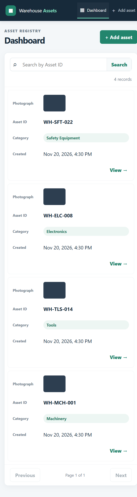
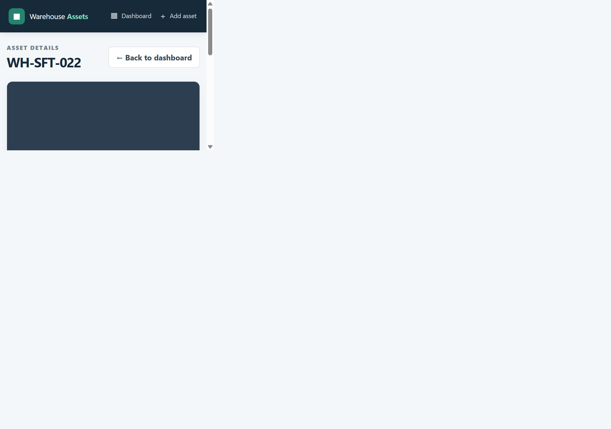
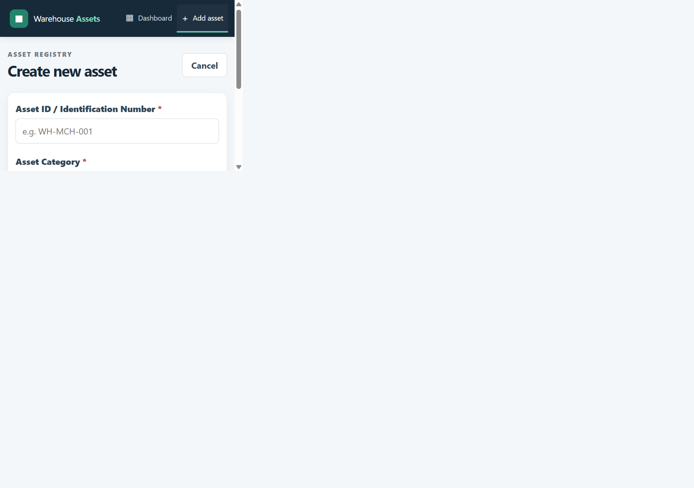
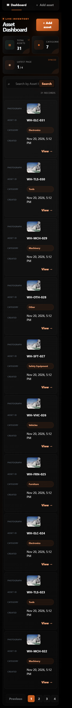

# Warehouse Asset Management Dashboard

A responsive warehouse asset registry built as a practical full-stack prototype. Operators can register an asset with an ID, category, and photograph; search the inventory; and inspect each saved record. The dashboard is designed for a warehouse computer on a local network while keeping the API boundaries ready for future barcode, RFID, or automated data sources.

**Live application:** [warehouse-asset-dashboard.vercel.app](https://warehouse-asset-dashboard.vercel.app)

## Features

- Register an asset with a validated unique Asset ID, category, and photograph
- Automatically store the creation date and UTC timestamp
- Save records in SQLite through a Flask REST API
- Search asset records by Asset ID, case-insensitively
- View an individual asset record and its uploaded photograph
- Review live summary metrics and an interactive category analytics chart
- Use the dashboard on desktop and mobile layouts
- Run the frontend and API on the same warehouse network

## Screenshots

| Dashboard | Asset details |
| --- | --- |
|  |  |

| Create asset | Mobile dashboard |
| --- | --- |
|  |  |

## Technology

| Layer | Technology |
| --- | --- |
| Frontend | React 19, Vite, responsive CSS |
| Backend | Python 3.12, Flask, Flask-CORS |
| Database | SQLite |
| File storage | Local uploads directory |
| Testing | Pytest and Vitest |
| Deployment | Vercel |

## Architecture

```text
Browser (desktop or mobile)
            |
            | REST/JSON and multipart image upload
            v
React application --> Flask API --> Services --> SQLite
                                   |
                                   +--> Photograph uploads
```

HTTP routes remain separate from validation and file-handling services. This allows a barcode scanner, RFID reader, IoT service, ERP, or WMS integration to submit assets through the same application boundary later.

## Quick Start

### Prerequisites

- Node.js 20+
- Python 3.12+

### 1. Start the API

```powershell
cd backend
py -m venv .venv
.venv\Scripts\Activate.ps1
pip install -r requirements.txt
Copy-Item .env.example .env
python app.py
```

The API starts on `http://localhost:5000`. Seed the local database with 30 demo records when needed:

```powershell
python seed.py
```

### 2. Start the Frontend

Open a second terminal:

```powershell
cd frontend
npm install
Copy-Item .env.example .env
npm run dev
```

Open `http://localhost:5173`.

## Local-Network Access

For phones or other computers on the warehouse network, use the warehouse computer's IPv4 address instead of `localhost`.

1. Run `ipconfig` and identify the active adapter address, for example `192.168.1.25`.
2. Set `VITE_API_BASE_URL=http://192.168.1.25:5000` in `frontend/.env`.
3. Add the frontend origin to `ALLOWED_ORIGINS` in `backend/.env`, for example `http://192.168.1.25:5173`.
4. Restart both services and open `http://192.168.1.25:5173` on the other device.
5. Allow inbound TCP ports `5000` and `5173` through the private Windows Firewall profile.

Do not point a mobile device at `localhost`; it would refer to the mobile device itself.

## API

| Endpoint | Description |
| --- | --- |
| `POST /api/assets` | Create an asset with multipart form data |
| `GET /api/assets?search=&page=&limit=` | List or search asset records |
| `GET /api/assets/:id` | Fetch one asset record |
| `GET /api/assets/:id/photograph` | Fetch an asset photograph |

`POST /api/assets` accepts `asset_identifier`, `category`, and `photograph`. Supported photographs are PNG, JPG, and JPEG files up to 5 MB. The API returns `201` on creation, `400` for invalid input, `409` for a duplicate Asset ID, and `413` for files that exceed the limit.

## Data Model

| Field | Notes |
| --- | --- |
| `id` | Auto-incremented primary key |
| `asset_identifier` | Required, unique, case-insensitive text identifier |
| `category` | Required category value |
| `photograph_path` | Relative storage path for the uploaded image |
| `created_at` | Automatically assigned UTC SQLite timestamp |

## Testing

```powershell
# Backend
cd backend
pytest -q

# Frontend production build and tests
cd frontend
npm run build
npm test
```

Backend coverage includes database initialization, create/read/search operations, duplicate protection, input validation, file type and size validation, and photograph persistence. Frontend coverage verifies category-distribution calculation logic.

## Deployment

The included Vercel configuration builds the React application and routes `/api/*` requests to the Flask serverless function.

```powershell
vercel login
vercel --prod
```

The production deployment uses temporary serverless storage for SQLite and image uploads. This is suitable for a demonstration, but a real deployment should use a persistent database and object storage before operational use.

## Limitations and Next Steps

- Authentication, operator roles, and audit history are not included
- Images cannot yet be replaced or deleted
- SQLite is appropriate for a small warehouse prototype, not high-concurrency use
- Uploads receive basic type and size validation; production use should add malware scanning
- Future integrations can include barcode/QR scanners, RFID readers, bulk import, ERP/WMS synchronization, and automated IoT feeds
